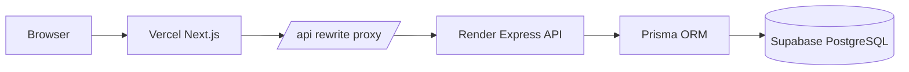

<div align="center">


Personal finance tracking with a polished olive design system, secure cookie authentication, and data-rich charts.

[](https://nextjs.org/)
[](https://www.typescriptlang.org/)
[](https://tailwindcss.com/)
[](https://expressjs.com/)
[](https://www.prisma.io/)
[](https://supabase.com/)
[](https://recharts.org/)
[](https://vercel.com/)
[](https://render.com/)
[](LICENSE)

[Live Demo](https://YOUR-VERCEL-APP.vercel.app) · [API](https://YOUR-RENDER-SERVICE.onrender.com/api/health)

</div>

## Overview

FinTrack helps users record income and expenses, understand category spending, review monthly trends, filter transaction history, and manage their profile and currency preference.

**Demo account**

| Email | Password |
|---|---|
| `demo@fintrack.app` | `Demo@1234` |

> Free-tier infrastructure may sleep when idle. The landing page status layer explains API and database availability and never locks users out of public content.

## Screenshots

Place application screenshots in [`docs/screenshots`](docs/screenshots).

| Dashboard | Transactions |
|---|---|
|  |  |
| Profile and settings | Mobile experience |
|  |  |

## Features

### 💰 Finance
- Create, edit, and delete income or expense transactions
- Integer minor-unit storage with maximum two-decimal amount validation
- Category chips, transaction notes, sorting, search, and pagination
- CSV export using the active filters

### 📊 Insights
- Income, expense, balance, savings rate, and transaction-count summary
- Spending-by-category donut chart with percentages
- Six-month-or-longer monthly income and expense trends
- URL-backed dashboard and history filters

### 🔐 Account and security
- Registration, login, logout, profile, password change, and demo login
- HTTP-only JWT cookie authentication and user-scoped Prisma queries
- Zod validation, rate limiting, Helmet, CORS, centralized errors, and bcrypt password hashing
- INR or USD display preference stored on the user

### 🎨 Experience
- Responsive olive dark/light design system
- Fixed glass navbar, mobile sheet, enterprise footer, and theme toggle
- Loading skeletons, empty states, availability cards, and friendly error boundaries
- Reusable status dialog and automatic polling for free-tier wake-up behavior

## Tech Stack

| Area | Technology |
|---|---|
| Web | Next.js 16 App Router, React 19 |
| Language | TypeScript |
| Styling | Tailwind CSS 4, shadcn/ui, Lucide React |
| Client state | Zustand, React Hook Form, React Context |
| Charts and motion | Recharts, Framer Motion |
| API | Express 5, Node.js ESM |
| Validation and auth | Zod, JWT, bcryptjs, HTTP-only cookies |
| Database | PostgreSQL on Supabase, Prisma |
| Deployment | Vercel client, Render API |

## Architecture



```mermaid
sequenceDiagram
  participant B as Browser
  participant C as Next.js
  participant A as Express API

  B->>C: POST /api/auth/login
  C->>A: Rewrite to Render API
  A->>A: Validate and verify bcrypt password
  A-->>C: Set-Cookie token=JWT; HttpOnly; SameSite=Lax
  C-->>B: Login response and cookie
  B->>C: GET protected page
  C->>A: GET /api/auth/me with cookie
  A->>A: Verify JWT and load user
  A-->>B: Public user profile
```

## Folder Structure

```text
fintrack/
├── client/
│   ├── src/app/              # App Router pages
│   ├── src/components/       # Layout, landing, auth, dashboard, shared UI
│   ├── src/hooks/            # Auth and dashboard data hooks
│   ├── src/lib/              # Axios, formatting, and site configuration
│   ├── src/providers/        # Backend status provider
│   ├── src/store/            # Zustand auth store
│   └── next.config.ts        # /api rewrite to API_ORIGIN
├── server/
│   ├── prisma/schema.prisma  # Prisma data model
│   ├── prisma/seed.ts        # Demo user and categories
│   ├── scripts/smoke.ts      # End-to-end API smoke checks
│   └── src/
│       ├── config/           # Environment and Prisma singleton
│       ├── controllers/      # Thin HTTP controllers
│       ├── services/         # Business and Prisma logic
│       ├── routes/           # Express route composition
│       ├── middlewares/      # Auth, validation, errors, and limits
│       ├── validators/       # Zod request schemas
│       ├── utils/            # JWT, cookies, errors, and helpers
│       └── types/            # Express declaration merging
├── docs/screenshots/
└── render.yaml               # Render deployment
```

## Getting Started

### Prerequisites

- Node.js 20 or newer
- npm
- A Supabase/PostgreSQL database

### Server

```bash
cd server
cp .env.example .env
npm install
npm run db:generate
npm run db:migrate
npm run db:seed
npm run dev
```

Server environment:

| Variable | Example | Required |
|---|---|---|
| `PORT` | `10000` | No |
| `NODE_ENV` | `development` | No |
| `CLIENT_URL` | `http://localhost:3000` | Yes in production |
| `DATABASE_URL` | Supabase pooled PostgreSQL URL | Yes |
| `DIRECT_URL` | Supabase direct PostgreSQL URL | Yes |
| `JWT_SECRET` | 32+ character secret | Yes |
| `JWT_EXPIRES_IN` | `7d` | No |

### Client

```bash
cd client
cp .env.example .env.local
npm install
npm run dev
```

Client environment:

| Variable | Example | Required |
|---|---|---|
| `API_ORIGIN` | `http://localhost:10000` | Yes; required in production |
| `NEXT_PUBLIC_APP_URL` | `http://localhost:3000` | SEO metadata |
| `NEXT_PUBLIC_DEMO_VIDEO_URL` | Video URL or empty | No |

Open `http://localhost:3000`.

## API Overview

| Method | Path | Auth | Description |
|---|---|---|---|
| GET | `/api/health` | No | Database-independent health response |
| GET | `/api/status` | No | Server and database availability |
| POST | `/api/auth/register` | No | Create an account |
| POST | `/api/auth/login` | No | Set the authentication cookie |
| POST | `/api/auth/logout` | No | Clear the authentication cookie |
| GET/PATCH | `/api/auth/me` | Yes | Get or update profile |
| PATCH | `/api/auth/password` | Yes | Change password |
| GET | `/api/categories` | Yes | List categories |
| GET/POST | `/api/transactions` | Yes | List or create transactions |
| GET/PATCH/DELETE | `/api/transactions/:id` | Yes | Read, update, or delete a transaction |
| GET | `/api/analytics/summary` | Yes | Filtered summary |
| GET | `/api/analytics/by-category` | Yes | Category totals and percentages |
| GET | `/api/analytics/monthly` | Yes | Zero-filled monthly totals |

## Deployment

### Render

1. Create a Blueprint or Web Service from the repository.
2. Render reads `render.yaml`; the service root is `/server`.
3. Set `CLIENT_URL`, `DATABASE_URL`, `DIRECT_URL`, and `JWT_SECRET`.
4. Deploy using migrations in the build command:
   - Generate Prisma Client
   - Compile TypeScript
   - Run `prisma migrate deploy`
5. Keep `/api/health` as the health check because it does not contact the database.

Do not seed during deployment. With production environment variables loaded locally, run `cd server && npx prisma db seed` once when the database is available.

### Vercel

1. Import the repository and set the project root directory to `client`.
2. Add `API_ORIGIN=https://YOUR-RENDER-SERVICE.onrender.com`.
3. Add `NEXT_PUBLIC_APP_URL=https://YOUR-VERCEL-APP.vercel.app`.
4. Optionally add `NEXT_PUBLIC_DEMO_VIDEO_URL`.
5. Deploy; Next.js proxies relative `/api/*` requests to Render.

## Security Notes

- JWTs are stored in HTTP-only, `SameSite=Lax` cookies and never returned as JSON or persisted in browser storage.
- Production cookies use `Secure`; CORS is restricted to `CLIENT_URL`.
- Passwords are hashed with bcryptjs at 12 rounds.
- Requests are scoped by the authenticated user; transaction relations are ownership checked in services.
- Amounts use integer minor units, never floating-point currency storage.
- Zod validates body and query data and the API returns centralized structured errors.

## Roadmap

- [ ] Add recurring transaction support
- [ ] Add downloadable monthly reports
- [ ] Add multi-account tracking
- [ ] Add budgets and spending alerts
- [ ] Add screenshot assets and a published walkthrough

## Contributing

1. Fork the repository.
2. Create a focused feature branch.
3. Run `npm run typecheck`, `npm run lint`, and `npm run build` in each app.
4. Keep API imports ESM-compatible and preserve user-scoped Prisma access.
5. Open a pull request with screenshots for UI changes.

## License

Licensed under the [MIT License](LICENSE).

## Author

**Saurabh Pandey**  
Full Stack Developer · Madhya Pradesh, India

- [LinkedIn](https://www.linkedin.com/in/saurabhpandey-/)
- [GitHub](https://github.com/SaurabhPandey016)
- [Email](mailto:developersaurabh001@gmail.com)

<div align="center">

Made with ❤️ by <strong>Saurabh Pandey</strong>

</div>
